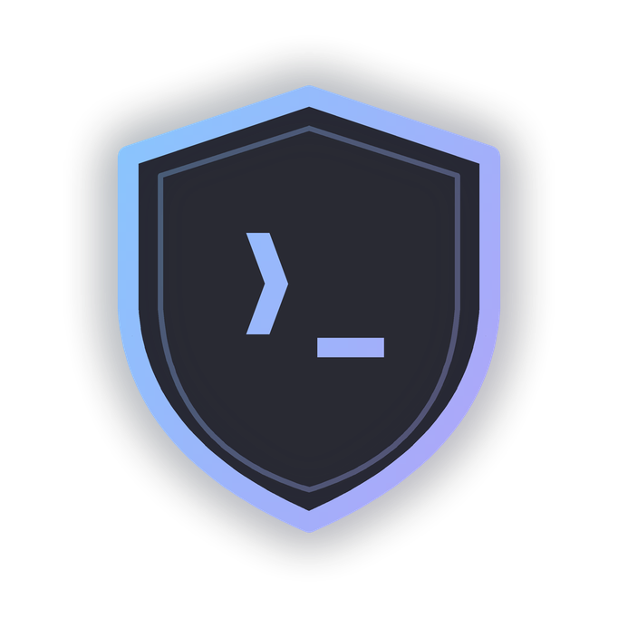
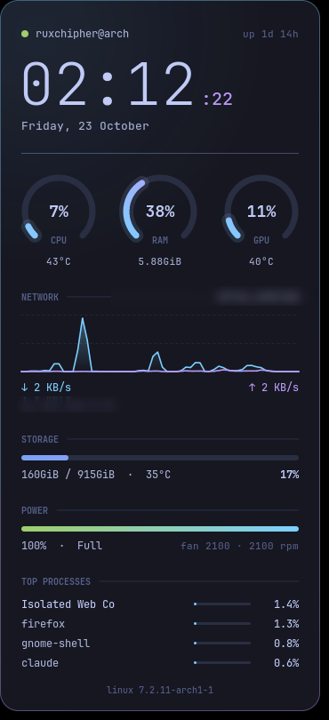
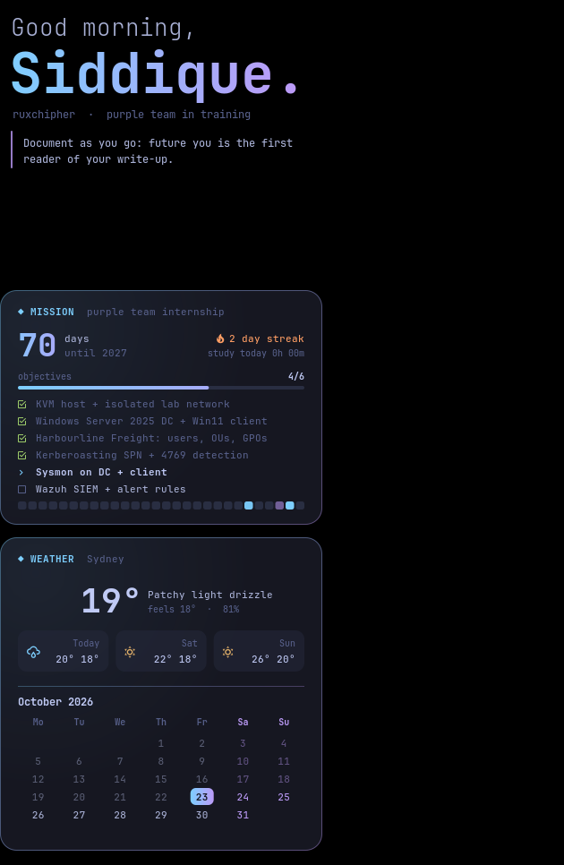
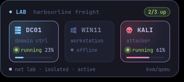
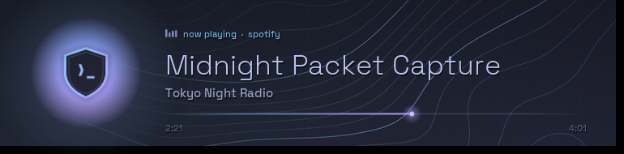
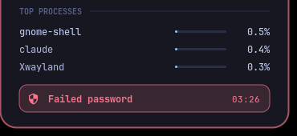
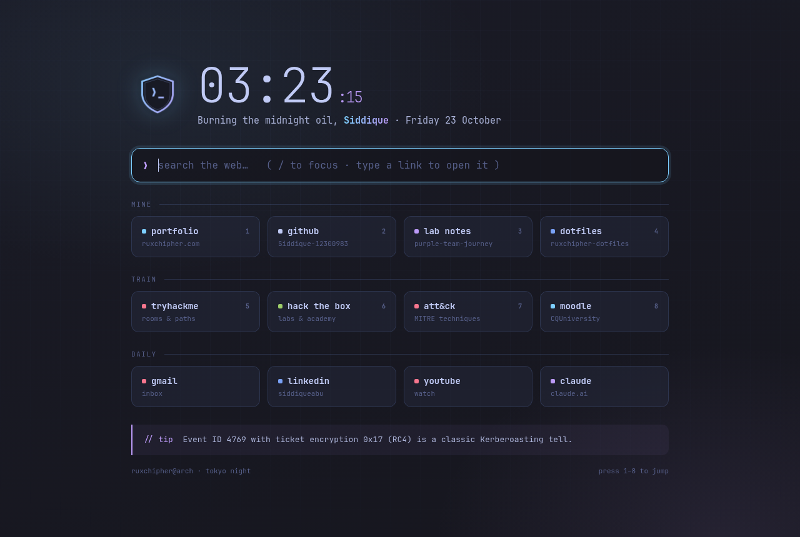
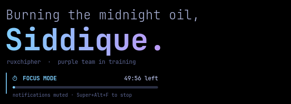
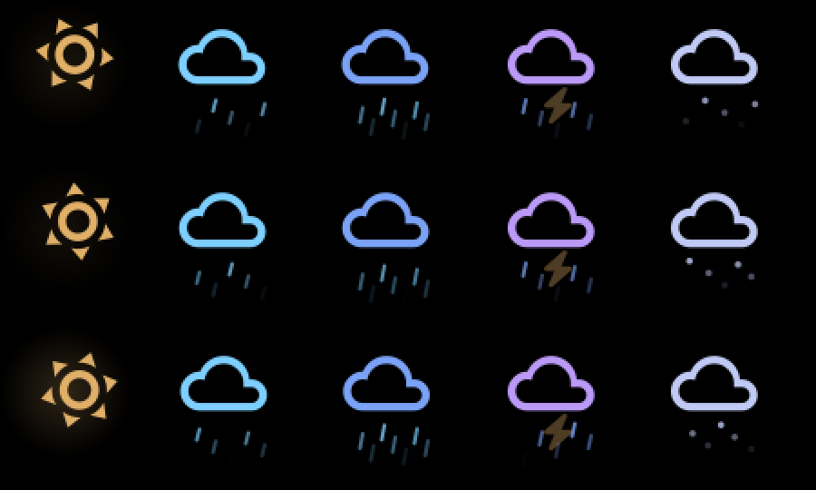

<p align="center"></p>

# ruxchipher dotfiles

My Arch Linux workstation (GNOME on Wayland), customised into a security-aware desktop in Tokyo Night colours,
from the boot screen to the browser start page. Part of my path to a purple team internship.
Portfolio: **[ruxchipher.com](https://ruxchipher.com)**

> **New machine?** Follow **[GUIDE.md](GUIDE.md)**. It's two commands: `./install.sh --user`, then optionally `./install.sh --system`.

| Main HUD | Left panels |
|---|---|
|  |  |

| Lab VMs (preview data) | Now playing (preview data) | Sentinel alert (preview) |
|---|---|---|
|  |  |  |

| Browser start page | Focus mode |
|---|---|
|  |  |

> The Wi-Fi name and local IP are blurred in the HUD screenshot.

## What's inside

### Desktop widgets (`.config/conky/ruxchipher/`)
Transparent widgets drawn from scratch in **Lua + cairo** on Conky.

- **`hud.lua`** (top right): clock; CPU / RAM / GPU gauges; temperatures; network graph; disk, battery and fans; top processes;
  and a **sentinel strip** that pulses red for 10 minutes after an alert. Click it, or press **Super+Alt+S**, for today's alert report.
  The GPU is only queried when it's already awake, so the widget never wakes the dGPU.
- **`lab.lua`** (bottom right): live status and CPU of the KVM lab VMs from `virsh domstats`.
- **`left.lua`**: greeting with a rotating security tip, which becomes a **focus-mode countdown** during study sessions;
  a **mission tracker** (countdown, objectives from `mission.txt`, a streak and heatmap from lab commits plus study time);
  Sydney **weather** and a calendar.
- **`wx.lua`**: the weather icon, **animated** (turning sun, falling rain, lightning, snow), but only for 6 seconds after a click
  or for 4 seconds every 10 minutes. Otherwise it's a still image, to save battery.
- **`media.lua`** (bottom left): now playing via `playerctl`. It fades out when nothing is playing.



### Security and lab tools (`.local/bin/`)
- **`ruxchipher-sentinel`**: a systemd user service that alerts on failed authentication (journal) and on new listening TCP ports.
  It's a learning project for host-based detection, not a replacement for a real IDS/EDR.
- **`sentinel-report`**: today's alerts with a plain-language explanation of each (`--all` for the full log).
- **`lab-up` / `lab-down`**: start the lab in order (DC first, clients after AD is up) and shut it down gracefully in reverse.
- **`focus-mode`**: 50-minute study timer that mutes notifications and logs study time to the mission streak.

### Welcome card
- **`ruxchipher-greeter`** (user service) + **`greet.lua`**: after login, and every time the screen is unlocked, a card fades in for
  ~3 s with a greeting, sentinel alerts while you were away, lab status and days to 2027. It's an override window, so it never steals focus.
- **Goodbye**: on logout, restart or power off, the screen dims, a "See you soon, Siddique." card fades in, then everything
  fades to black (~3.5 s) while the desktop is still up. The greeter registers as a **GNOME session client**: gnome-session waits
  for every client to answer `EndSession`, so it answers after the animation. (A logind delay inhibitor didn't work: GNOME tells
  logind to skip inhibitors on reboot, and Plymouth's shutdown screen is on for under a second.)

### System (`system/`, installed by `./install.sh --system`)
- **Boot splash** (Plymouth script theme): the dimmed wallpaper with the shield logo fading in. Kept minimal on purpose,
  because the splash is only on screen for about a second on this laptop (see the closed issues).
  The UKI firmware splash is the shield too.
- **Login screen**: shield logo and an "authorised access only" banner.
- **Browser start page**: clock, search, and quick links to my portfolio, repos and training sites, for Chrome, Firefox and GNOME Web.
- **Lid-hibernate hook**: hibernates after 45 minutes with the lid closed on battery, even if the laptop keeps waking itself (it used to drain overnight).

- **`conky-clickable`** (`tools/conky-clickable.c`): Conky makes undecorated windows click-through; this small Xlib helper
  restores mouse input for the HUD and weather icon so their click actions work.

### Look and feel
- Tokyo Night colours for GTK3/GTK4 (libadwaita) apps, **Papirus-Tokyo** icons (violet folders), a generated 4K wallpaper.
- **fastfetch** terminal greeting, **ddterm** drop-down terminal on F12, clipboard history on Super+V.

## Shortcuts

| Keys | Action |
|---|---|
| F12 | drop-down terminal |
| Super+V | clipboard history |
| Super+Alt+L / Super+Alt+Shift+L | lab up / lab down |
| Super+Alt+F | focus mode on/off |
| Super+Alt+S | sentinel alert report |

## Repo layout

```
.config/  .local/      user files (copied to ~ by install.sh, with paths adjusted)
gnome/                 dconf dumps + keyboard shortcuts
system/                boot splash, logo, GDM, browser policies, lid hook
tools/                 generators for the logo, boot images, wallpaper and start page
wallpapers/            the generated wallpaper
install.sh  GUIDE.md   installer + step-by-step guide
```

## License

MIT
